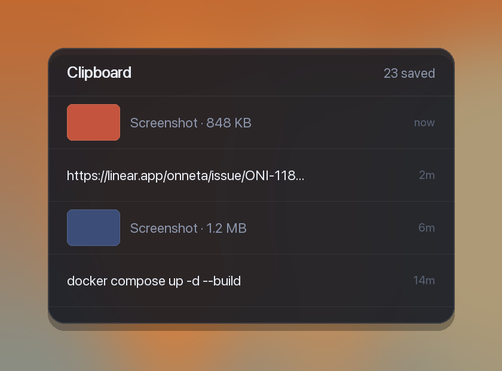

# copycat

**Everything you copy, kept.**

The last 40 things you copied — text *and* screenshots — sitting on your macOS
desktop. Click one to put it back on your clipboard. For every time you copied
something over the thing you actually needed.

Runs on [Übersicht](https://tracesof.net/uebersicht/).



---

## Read this before installing

**This records what you copy.** That's the whole point, and it's the part to
think about first.

It refuses to store anything matching a known credential shape — `sk-ant-`,
`lin_api_`, GitHub tokens, AWS keys, JWTs, private keys, and any long unbroken
token-like string. That is pattern matching, **not a guarantee**. A password
that looks like an ordinary word will be stored.

It also **cannot see inside images**. Screenshot something with a key visible
and it's saved as a picture.

Everything stays on your Mac, mode `600`. Nothing is uploaded.

Clear it any time:

```bash
echo '[]' > ~/.cache/ai-usage/clipboard.json
```

Stop it entirely:

```bash
launchctl unload ~/Library/LaunchAgents/com.copycat.clipwatch.plist
```

If that trade isn't worth it to you, don't install it. That's a reasonable
conclusion.

---

## Install

```bash
git clone https://github.com/majdiq1/copycat.git
cd copycat
./install.sh
```

Then: Übersicht menu bar → **Refresh All Widgets**.

Remove it with `./uninstall.sh` — that stops the watcher and deletes the
history and every saved image.

---

## Using it

**Copy something.** It appears at the top within about three seconds. You don't
do anything else.

**Get it back.** Click any row. That entry goes onto your clipboard, ready to
paste. Hovering shows *copy* so you know the row is clickable.

**Screenshots work the same way.** Take one with Cmd+Ctrl+Shift+4 (the Ctrl
puts it on the clipboard rather than saving a file). It appears with a small
preview and its size. Click it and a real image goes back on your clipboard —
paste it straight into Slack or a chat.

**Scroll** for older entries. The widget lists 5 at a time and keeps 40.

**Copied the same thing twice?** It moves back to the top instead of appearing
twice.

### The one habit worth having

If you copy a password, or screenshot something with a key on screen, clear it:

```bash
echo '[]' > ~/.cache/ai-usage/clipboard.json
```

The filter catches things shaped like API keys, but it can't recognise an
ordinary-looking password and it can't read text inside an image.

---

## How it works

A small Python script runs in the background as a LaunchAgent, checking the
clipboard every 1.5 seconds. New entries go to the top; copying the same thing
twice moves it up rather than duplicating it. Only the last 40 are kept, and
images no longer in the list are deleted from disk.

**Screenshots are the interesting part.** `pbpaste` returns nothing at all for
images, which is why most clipboard scripts miss them. This reads the pasteboard
through AppleScript as raw PNG instead, saves the file, and makes a small
thumbnail with `sips` to show inline. Clicking one puts a real PNG back on the
clipboard, not a file path.

```
~/.cache/ai-usage/clipboard.json    the list
~/.cache/ai-usage/clips/            full-size images
```

---

## Options

At the top of `widget/clipboard.jsx`:

| | |
|---|---|
| `POSITION` | Where it sits, CSS against the screen edges |
| `WIDTH` / `HEIGHT` | Default 340 × 230 |
| `SHOW` | Entries listed before scrolling, default 5 |
| `refreshFrequency` | Default 3000 (3 seconds) |

In `bin/clipwatch.py`: `MAX_ITEMS` (40), `MAX_LEN` (4000 characters per entry),
`THUMB_PX` (150), `POLL` (1.5s), and `SECRET_PATTERNS` — add your own patterns
there if you handle credentials this doesn't recognise.

---

## Troubleshooting

**Nothing appears** — check the watcher is alive:

```bash
pgrep -fl clipwatch.py
cat /tmp/clipwatch.err
```

**Screenshots don't show** — macOS may need to grant automation permission the
first time it reads the pasteboard through AppleScript. Copy an image, then
check for a permission prompt.

---

## Licence

MIT. See [LICENSE](LICENSE).
